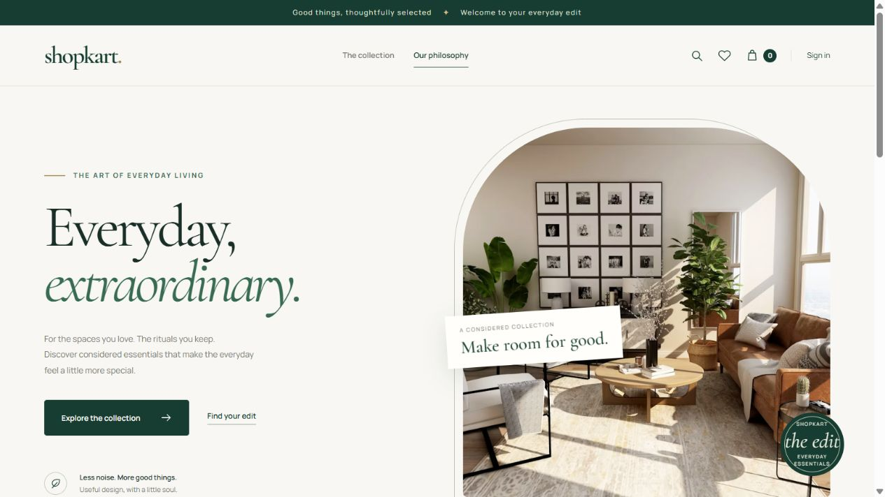

# ShopKart

**Everyday, considered.** A full-stack storefront built with React, Express, MongoDB, and Razorpay Test Mode. ShopKart combines a responsive editorial design with authenticated shopping, persistent wishlists and carts, and server-verified checkout.



## Features

- Premium ivory and forest-green interface with responsive navigation and layouts.
- Lenis smooth scrolling, scroll reveals, and reduced-motion support.
- Searchable product catalogue, category filters, price sorting, and product details.
- Registration, login, persistent HTTP-only cookie sessions, and protected account pages.
- Customer account APIs, registration, a Home profile summary, and secure password change.
- Persistent wishlists and stock-aware cart quantities with server-side validation.
- Shipping form validation and server-calculated INR totals.
- Razorpay Test Mode checkout with signed callback and captured-payment verification.
- Separate success, failure, cancellation, and pending-confirmation experiences.
- Recoverable confirmation retry after a network failure or page refresh in the same browser session.
- Signed payment webhooks and an order-level payment status check when the browser callback is lost.
- Order history, purchase-time item snapshots, and fulfilment tracking.
- Trusted operator access for product creation, restocking, customer order support, and fulfilment progression.
- Non-destructive sample catalogue seed, API readiness check, regression tests, and CI workflow.

This is a portfolio/learning application with a working Test Mode payment integration. It does not enable real-money payments. See [deployment requirements and limitations](docs/DEPLOYMENT.md) before putting it online.

## Prerequisites

| Requirement | Details |
| --- | --- |
| Node.js | Node 22.13+ within the 22.x line, or Node 24+. Node 22 is selected by `.nvmrc` and CI. |
| npm | Included with Node; use the checked-in lockfiles. |
| MongoDB | Atlas or a local replica set. Checkout requires transactions; standalone MongoDB is insufficient. |
| Razorpay | Test Mode key ID and key secret, with automatic capture configured. Optional for browsing and cart development. |
| Internet | Required for hosted catalogue images, Google Fonts, and Razorpay Checkout. |

## Quick start

Run commands from the repository root in PowerShell, Terminal, or your preferred shell.

### 1. Install dependencies

```sh
npm ci
npm run setup
```

`setup` installs the backend and `client/frontend` packages using their lockfiles. There is no need to install the intermediate `client` package; it is a legacy command wrapper.

### 2. Create local environment files

PowerShell:

```powershell
Copy-Item backend/.env.example backend/.env
Copy-Item client/frontend/.env.example client/frontend/.env
```

macOS/Linux:

```sh
cp backend/.env.example backend/.env
cp client/frontend/.env.example client/frontend/.env
```

Edit `backend/.env` and replace the database URL, JWT secret, and Razorpay placeholders. Generate a private JWT secret with:

```sh
node -e "console.log(require('crypto').randomBytes(32).toString('hex'))"
```

Keep that output private and paste it into `jwt_secret`. Never commit actual `.env` files. The frontend environment contains only the public API URL.

### 3. Configure MongoDB

**Atlas:** create a database deployment, create a database user, allow your development IP, and copy the driver connection string into `dbUrl`. Include a database name such as `shopkart` and URL-encode reserved characters in credentials. Atlas supports the transactions used by checkout.

**Local replica set:** with `mongod` and `mongosh` installed, create a data directory and start a dedicated development instance. Keep the server terminal open:

```powershell
New-Item -ItemType Directory -Force .local/mongodb | Out-Null
mongod --dbpath .local/mongodb --replSet rs0 --bind_ip 127.0.0.1 --port 27017
```

In a second terminal, initialise it once:

```sh
mongosh --host 127.0.0.1 --port 27017 --eval "rs.initiate({_id:'rs0',members:[{_id:0,host:'127.0.0.1:27017'}]})"
```

Wait for the member to become PRIMARY. Use the example URL:

```dotenv
dbUrl=mongodb://127.0.0.1:27017/shopkart?replicaSet=rs0
```

The local commands assume port 27017 is free. Do not start a second MongoDB process on the same port or reuse a running service's data directory.

### 4. Add the sample catalogue

```sh
npm run seed
```

This inserts ten sample products across Electronics, Home, Fashion, and Books. Running it again preserves existing products and stock, matching sample products by name. It does not create users, delete products, or reset the database. Register your own account through the UI.

### 5. Start the app

```sh
npm run dev
```

| Service | Local URL |
| --- | --- |
| Storefront | http://localhost:5173 |
| API | http://localhost:8085 |
| API readiness | http://localhost:8085/health |

The API starts after MongoDB connects. Vite uses a fixed port and reports a conflict instead of silently changing ports. Use `localhost` consistently when opening the frontend and configuring its API URL; mixing it with `127.0.0.1` can affect cookies and CORS.

To run separate terminals:

```sh
npm run backend
npm run client
```

Stop development servers with Ctrl+C.

## Environment reference

### Backend: `backend/.env`

| Variable | Required | Purpose |
| --- | --- | --- |
| `dbUrl` | Yes | MongoDB URI with transaction support. The name is case-sensitive. |
| `jwt_secret` | Yes | Private random secret used to sign ten-day authentication tokens. |
| `PORT` | No | API port; defaults to `8085`. |
| `CLIENT_ORIGIN` | No | Comma-separated browser origins allowed to send credentials. Defaults to `http://localhost:5173`. |
| `RAZORPAY_KEY_ID` | For checkout | Test key starting with `rzp_test_`. |
| `RAZORPAY_KEY_SECRET` | For checkout | Matching private Test Mode secret. |
| `RAZORPAY_WEBHOOK_SECRET` | For hosted checkout | Separate secret for the signed `/webhooks/razorpay` endpoint; required in production. |
| `NODE_ENV` | No | `production` enables HTTPS-only authentication cookies. |
| `COOKIE_SAME_SITE` | No | `lax` by default; `none` supports cross-site HTTPS hosting. |
| `ADMIN_EMAILS` | No | Comma-separated trusted account emails; empty disables administrative writes. |
| `TRUST_PROXY` | No | Number of trusted reverse-proxy hops, `0` locally. Configure exactly for your host so rate limiting sees the correct client IP. |

Create the trusted account yourself **before** adding its email to `ADMIN_EMAILS`, then restart the API and sign in again. Public signup cannot claim an already allowlisted email. Operators can open a customer's order reference, restock through the API, retry reviewed fulfilment without another charge, and advance paid orders. There is no store-wide admin listing/dashboard. Registration does not verify email ownership; provision trusted accounts yourself.

### Frontend: `client/frontend/.env`

| Variable | Default | Purpose |
| --- | --- | --- |
| `VITE_API_URL` | `http://localhost:8085` | Public API origin without an additional path prefix. |

Restart Vite after changing environment files. Frontend environment values are compiled into the build and are visible to visitors; never put secrets in `VITE_*` variables.

## Try the complete shopping flow

1. Open the collection, search for an item, and try category and price filters.
2. Create an account and sign in. Save a product to your wishlist.
3. Add products to the bag, adjust quantities, and confirm stock limits and totals.
4. Open checkout and enter a valid delivery address, a 10–12 digit phone number, and a six-digit pincode.
5. Use Razorpay Test Mode's success/failure controls; do not enter real banking credentials.
6. On success, the API validates the signature, gateway order, amount, currency, and captured status. The transaction marks the order paid, deducts stock, and removes only purchased quantities from the bag. New or re-added cart lines are preserved. The UI opens order details.
7. On failure or modal cancellation, the cart remains intact and the result is recorded.
8. If confirmation is pending, choose **Retry confirmation**. This reuses the original payment proof instead of starting another payment. Refresh recovery lasts within the same browser tab session; do not close the tab while resolving a pending payment.
9. Open **Your orders** to review payment and fulfilment status.
10. If the browser callback was lost, open the order and choose **Check payment status**. Signed webhooks can also complete the order while the customer is offline. A captured payment with unavailable stock is recorded as **PAYMENT_REVIEW**; follow the operator recovery procedure in the release guide.

Automatic payment capture must be configured in the Razorpay Test dashboard. An authorised payment is shown as pending until capture. Payments cannot be simulated using a fake signature.

## Commands

| Command from root | Action |
| --- | --- |
| `npm ci` | Install root tooling. |
| `npm run setup` | Install backend and frontend dependencies. |
| `npm run dev` | Start API and frontend together. |
| `npm run backend` | Start API with file watching. |
| `npm run backend:start` | Start API without file watching. |
| `npm run client` | Start the Vite dev server. |
| `npm run seed` | Add missing sample products. |
| `npm test` | Run backend and payment-lifecycle regression tests. |
| `npm run lint` | Check backend JavaScript syntax and run frontend ESLint. |
| `npm run build` | Build the frontend into `client/frontend/dist`. |
| `npm run preview` | Preview that build at http://localhost:4173. |
| `npm run check` | Run lint, tests, and build. |
| `npm run test:integration` | Exercise real MongoDB transactions in a disposable replica set. |
| `npm run test:e2e` | Run desktop/mobile Chromium flow tests against an isolated app. |
| `npm run check:release` | Run the full unit, build, database, and browser release gate. |

For preview authentication, add `http://localhost:4173` to backend `CLIENT_ORIGIN`, restart the API, and keep it running. Preview serves the frontend only.

`npm test` uses mocked database/payment operations and local HTTP routing. Integration and browser tests start a disposable MongoDB replica set, use real application HTTP routes and transactions, and replace only the external gateway. They never use `dbUrl` or your existing database and do not create real payments. On first use MongoDB binaries are downloaded; install the browser once with `npx --prefix client/frontend playwright install chromium` (add `--with-deps` on Linux). CI runs the full release gate without private credentials. See [release verification](docs/RELEASE.md).

## Project structure

```text
ShopKart/
├── .github/workflows/ci.yml    # Automated lint, regression tests, and build
├── backend/
│   ├── app.js                # Express app, CORS, routes, readiness, errors
│   ├── index.js              # Environment, DB connection, server lifecycle
│   ├── config/               # Environment and Razorpay client
│   ├── controllers/          # Auth, catalogue, wishlist, cart, and orders
│   ├── middleware/           # Authentication and administrative authorization
│   ├── models/               # Customer, product, and order schemas
│   ├── routes/               # HTTP endpoints
│   ├── test/                 # HTTP and commerce regression tests
│   └── seed.js               # Non-destructive sample products
├── client/frontend/
│   ├── public/               # Favicon and static assets
│   ├── src/components/       # Shared UI, navigation, motion, error fallback
│   ├── src/context/          # Authentication and cart state
│   ├── src/pages/            # Storefront and account routes
│   ├── src/services/         # API functions
│   ├── src/utils/            # Checkout loader and payment lifecycle
│   └── test/                 # Payment callback race/recovery regression tests
├── docs/                     # API, architecture, deployment, manual QA
└── scripts/                  # Repository checks
```

## Troubleshooting

| Symptom | Check |
| --- | --- |
| API exits on startup | Fill `dbUrl` and `jwt_secret`; verify MongoDB connectivity and Atlas IP access. Startup times out after 10 seconds. |
| `ENOTFOUND` or SRV lookup errors | Check the Atlas hostname and your system/network DNS. The app uses the system resolver. |
| Transaction errors | Use Atlas or an initialised replica set, not a standalone MongoDB server. |
| No products | Run `npm run seed` against the same database as the API. |
| Port already in use | Stop the old server or change the port and its corresponding origin/API settings. |
| Login appears not to persist | Use matching hostnames, an exact `CLIENT_ORIGIN`, and the correct cookie settings. Local HTTP needs `NODE_ENV=development`. |
| Checkout unavailable | Supply matching Razorpay Test Mode credentials; the rest of the shop can run without them. |
| Confirmation pending | Retry confirmation for the same payment. Check capture settings and DB transactions before trying another payment. |
| Admin action returns 403 | Provision the trusted account, configure `ADMIN_EMAILS`, restart the API, and sign in again. |
| Deep link returns host 404 after deploy | Configure SPA rewrites to `index.html` on the frontend host. |
| Styling/images/fonts incomplete offline | Fonts and catalogue photography use external hosts. Local fallbacks apply to fonts. |

## Further documentation

- [Architecture and payment lifecycle](docs/ARCHITECTURE.md)
- [API reference](docs/API.md)
- [Deployment and known limitations](docs/DEPLOYMENT.md)
- [Release gate, webhook setup, and support runbook](docs/RELEASE.md)
- [Manual acceptance checklist](docs/TESTING.md)

- [Contributing](CONTRIBUTING.md)
- [Security notes](SECURITY.md)

The repository has no declared open-source license. Confirm ownership and select an appropriate license before redistribution. Sample product photos are hosted by Unsplash; review asset usage terms before a commercial launch.
